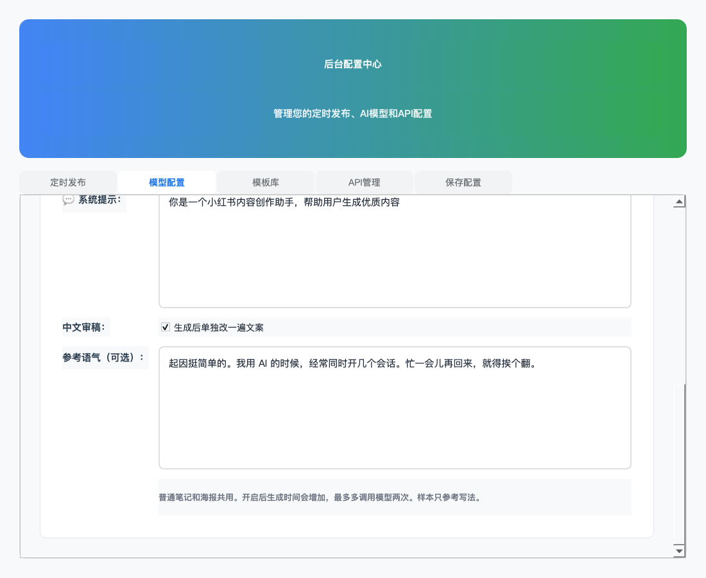

# 中文文案

普通笔记和营销海报共用从 [jiji262/humanizer-chinese](https://github.com/jiji262/humanizer-chinese) 适配的中文审稿模块。规则和设置解析在 `src/core/services/chinese_writing_editor.py`，`writing_guidelines.py` 负责组合它与事实约束，`llm_service.py` 的两个生成入口负责调用。

## 使用

打开「后台配置 → AI模型配置」：

- 「中文审稿」默认启用，也可以关闭。关闭后仍保留现有素材与事实约束。
- 「参考语气」可以贴一小段自己的原文。只参考用词、句长和过渡习惯，不能把样本里的经历、名字、数字或功能带进本次稿件。留空时沿用本次原稿的语气。
- 点击保存后，下一次生成使用这些设置。设置适用于普通笔记和海报。

模型配置中的对应字段为 `chinese_editor_enabled`（布尔值，缺省为 `true`）和 `writing_sample`（字符串，缺省为空）。改稿使用当前配置的模型；替换写作规则无需改图片排版或模型接口。

重点保留作者原来的用词和起因，按文章的阅读顺序分页；不强迫正文先列用途，不为每个功能凑一页，也不靠虚构经历、堆口头禅或错别字制造口语感。相关操作和使用条件一起保留。

2026-10-12 起，先生成初稿，再用随项目附带的完整 Skill 单独改正文。改稿可以重组段落和句子，正文确定后再分页，图片文字与正文保持一致。改稿不再沿用初稿的功能小标题、封面副标题和卖点列表，避免正文改了，图片还用旧文案。

改稿会多调用一次模型。格式或基础事实检查不通过时，带着具体问题再试一次；仍不通过时保留初稿，界面明确提示“中文改稿未完成”。关闭开关，或素材明确要求只改错字、原样保留时，不调用独立改稿。

基础检查会拦截部分新增数字、英文名称、中文引语和明显虚构的个人经历，并检查原稿的数字、英文名称是否保留。它不是完整的语义校验，无法判断所有经历和功能说法是否真实，也不能保证改稿有吸引力。作者仍需核对事实、语气和使用条件。

## 来源

- 上游：[SKILL.md](https://github.com/jiji262/humanizer-chinese/blob/main/SKILL.md)，2026-10-11 获取的版本标记为 `1.0.0`。
- 本次参考文件的 SHA-256：`d582f32dd18f5dfcba881a65b8718ab293761ec6ea0a5fad14d81e2fe0899c1a`。
- 许可证：[MIT 许可证与版权声明](licenses/humanizer-chinese-LICENSE)。
- 完整规则保存在 `templates/writing/humanizer-chinese.md`，许可证同目录保存；调用和基础检查在 `ChineseWritingEditor` 所在模块，初稿中的适配规则仍在 `CHINESE_EDITOR_GUIDELINES`。

## 这次试写

用相同的办公小镇素材、作者语气样本和 qwen-plus，对 humanizer-chinese、humanizer-zh、blader/humanizer 各跑了一次。作者选择了 humanizer-chinese 的方向。试写为单次采样比较，不构成对三个项目的普遍排名。

第一版比较接近作者原来的叙述，但也加入了没有依据的限定，比如把“结果由我确认”写成“每一步结果都由我确认”。这些限定不能直接用于正式介绍。新规则特别提醒检查量词、范围和上下文来源。

适配后的普通笔记和海报生成也各跑了一次，均成功生成正文与图片。这次正文大部分保留了原稿，表达仍偏保守，海报部分页标题仍较长。规则改善了写作要求，不代表每篇生成稿都达到了作者偏好的语气。

文案、图片文字、实际操作条件仍要一起检查。原稿中的事实可以换一种顺口的表达，事实本身不能因为润色而扩大。

## 2026-10-12 再试

仅在初稿中加入审稿规则，办公小镇的生成正文仍几乎照抄素材。因此改成独立改稿，让模型直接修改完整文章，不再同时填写海报提纲。

实际试写仍出现过虚构个人经历、超长标题、增加“不越权”等说法。完整 Skill 也不能解决所有写作问题。基础检查失败时保留初稿；通过检查只说明没有触发这些规则，不代表全文真实或已经好看。

这次另外人工改了一版，以“离开电脑，也能接着改代码”为题，从补一句要求这件事说起，再交代几个任务和管家的用法。推荐稿与模型原始输出分别保存，没有把人工稿当成自动生成效果。截图与正文用生产渲染器生成预览，并修复了无页标题时截图下移、压住正文的问题。
