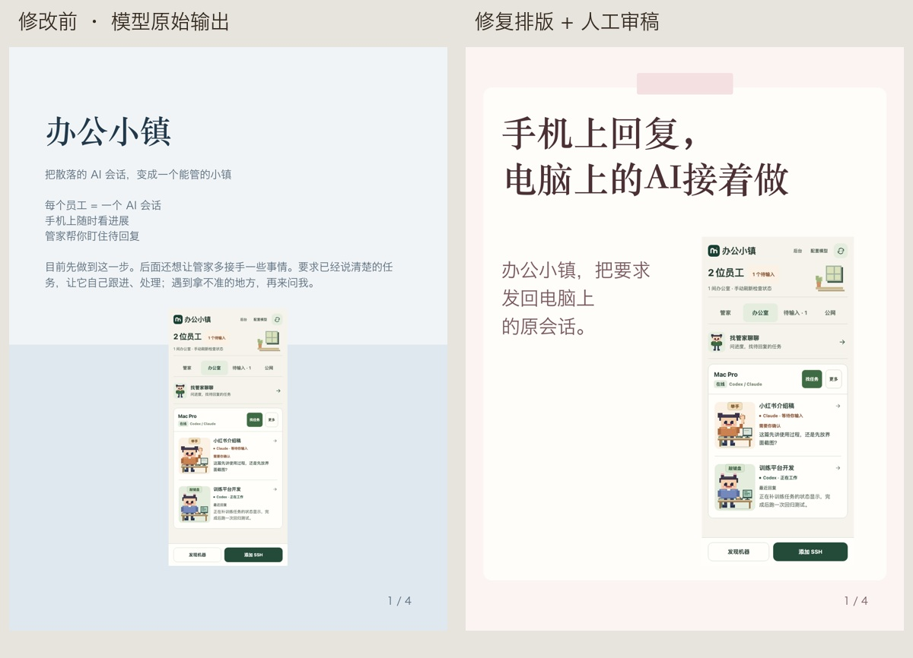
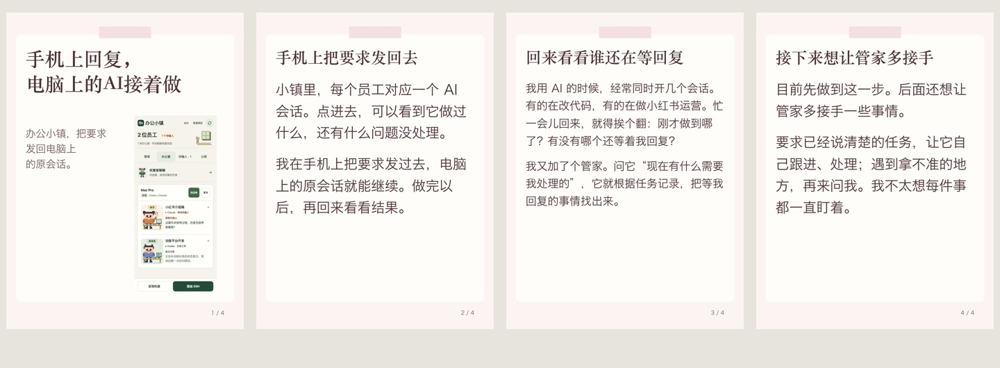

# 文案和海报生成检查 · 2026-10-11

同一份办公小镇原稿，复用本机已配置的阿里云 qwen-plus。未登录或提交小红书。模型密钥只在进程内存中使用，没有写入测试产物。

## 实测问题

普通笔记原始标题为“我在做一个叫办公小镇的小项目”，封面重复开场白，第一页只有一句介绍。默认提示词只让模型改重复和分段，没有要求提炼具体用途。

海报原始标题为“办公小镇”。生成结构仍预设内容一览、亮点、痛点、人群等栏目；这条生成入口没有加入共享的素材核对规则。实际输出出现“管家主动提醒”“需要轻量提醒，不是重流程”等原稿没有支持的说法。完整发布正文只剩开头一句，后续计划被放进封面的声明区。

排版把竖版手机截图限制在 904 × 635 区域中。示例原图为 396 × 844，缩成约 298 × 635，手机信息难以阅读。旧封面同时堆标题、副标题、卖点和声明，层次分散。这部分排版来自前一轮本地修改。

## 本次修改

- 默认笔记提示词允许从素材提炼具体操作用途，保留原稿语气和事实；明确要求只改错字时仍遵守编辑范围。
- 海报入口接入共享素材核对规则。新的模型输出使用 `pages: [{title, body}]`，按内容组织，不强制填营销栏目。
- `caption` 要求返回完整发布稿；空关键词不再自动变成“咨询”。
- 渲染器接受新阅读页，旧字段仍能渲染。长正文继续分页，不截断尾部事实。
- 新图文封面使用全宽标题，竖版截图与补充说明并排。截图完整缩放，不裁掉顶部、底部，不添加虚构界面。横版素材和旧稿保留原来的包含式布局。

## 原始输出与人工审稿

第二轮修订后的模型标题为“手机上查AI会话进展”。生成结果保留了后续计划，但仍出现“用户问了才回答，不是主动提醒”这样的生硬说明，标题也偏普通。不能把它当作已经达到宣传成稿的证据。

另做人工审阅版：“手机上回复，电脑上的AI接着做”。删掉规则说明，按手机处理、找待回复的问题、后续计划组织正文。模型原始输出没有被覆盖，两份稿单独保存。

对比图右侧包含人工编辑，不能据此把全部文案改善归因于提示词。没有测点击率，也没有承诺减少违规或封号。

素材手机截图来自 agentBridge 已有的 `docs/screenshots/office-zh-0.5.51.png`，是演示素材，不是此次重新连接手机拍摄。

## 复核

103 个相关测试通过，覆盖新模型分页字段到渲染器的传递、旧稿兼容、完整截图、长正文保留、文案生成和既有发布保护。模型实测使用同一输入、同一配置，但模型采样具有随机性，几次样例不足以证明所有主题的生成质量。

[原始素材](quality-audit-20261011/source.txt) · [修改前笔记](quality-audit-20261011/before-note.json) · [修改前海报](quality-audit-20261011/before-poster.json) · [修订后笔记](quality-audit-20261011/after-note.json) · [修订后海报](quality-audit-20261011/after-poster.json) · [人工审阅稿](quality-audit-20261011/reviewed-copy.md)
