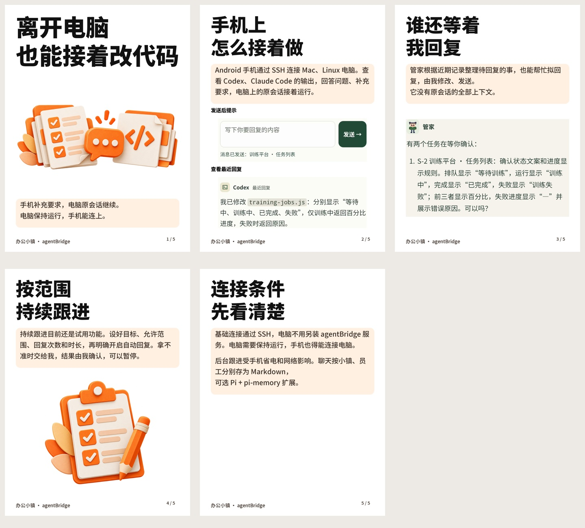

# 橙白立体模板

打开「封面中心」，在模板列表直接选「橙白立体」，再点「应用到首页」。返回首页输入素材，使用原有的文案生成流程，导出的封面与内容图会用这套版式。设置会保存，重新打开程序后继续使用。

模板采用白底、橙色立体纸张素材、黑色大标题。标题与正文是可修改的文字，每次生成重新排版。默认立体素材适合工具、资料类介绍，其他题材可以换自己的封面图和正文配图。明确留空的正文图片位置不会补入插画。

配图保持输入图片的比例和内容，不生成或修改 APP 对话、状态与结果。长文会继续分页，后续文字页不重复配图。价格、说明与限制按原始输入保留，模板不会添加货币单位、价格、统计数字或领取话术。

## 示例

示例采用人工整理的办公小镇文案，保留电脑运行、SSH 连接、后台省电限制，以及持续跟进的试用状态、明确开启和人工确认等条件。配图沿用已有 APP 演示截图，不代表本次新进行了实机操作。这个示例验证的是实际项目模板的渲染效果，不能用来说明模型已经自动写出了同样的正文。

## 实现与素材

- 生成入口仍为 `MarketingPosterService`；`poster_layout: "orange_paper"` 使用 `orange_paper_renderer.py`。
- 与截图模板共用内容解析、分页及输出文件规则；标题、正文和价格来自同一份生成结果。
- 内置插画位于 `assets/orange_paper`，2026-10-12 用内置 imagegen 生成，具有透明通道。素材与提示词见[素材说明](../assets/orange_paper/README.md)。运行时不调用绘图服务；原有的文案模型请求照常执行。
- 字体使用 [Noto Sans SC](https://github.com/google/fonts/tree/main/ofl/notosanssc) 的 900 和 500 字重，原始字体与完整 [SIL OFL 许可证](../assets/fonts/OFL-NotoSansSC.txt) 一起打包在 `assets/fonts`。
- Nuitka 原有构建脚本包含整个 `assets` 目录，无需另加绘图服务或运行时字体下载。

本次在 Mac 本地验证了模板导出、长文与价格保留、不同尺寸的文字边界、上传图片不被修改、透明素材，以及界面选择、保存和重新打开。Windows 打包与安装没有在本次执行。
