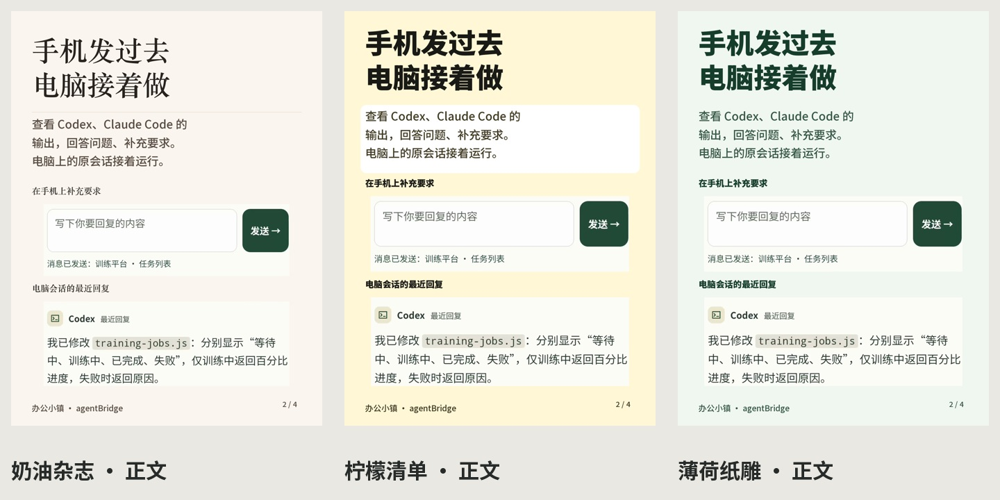

# 海报模板

2026-10-12 的本地版本把模板列表精简到 13 款，另外保留默认样式。打开「封面中心」，在左侧选择模板，点「应用到首页」，再回到首页生成。模板选择会保存。

| 模板 | 适合的内容 |
| --- | --- |
| 橙白立体 | 粗黑标题、橙白纸雕，介绍产品或工具 |
| 奶油杂志 | 米白底、宋体标题，放大产品和操作截图 |
| 柠檬清单 | 黄色底、白色文字区，写步骤和清单 |
| 薄荷纸雕 | 深绿标题、绿色立体插画，写任务和使用过程 |
| 大截图图文 | 简短说明配大截图 |
| 产品展示·专业 | 展示自己的产品配图 |
| 垂直时间线·优雅 | 按原稿顺序讲步骤 |
| 对比图表·冷色 | 按提供的段落做对比 |
| 数据指标卡·方案2·专业 | 展示素材中明确提供的数据 |
| 简洁笔记 | 普通介绍和使用记录 |
| 粉色便签 | 随手记、个人记录 |
| 课程介绍·优雅 | 课程和操作讲解 |
| 金句卡片·方案2·优雅 | 一段短文字 |

本次新增的是奶油杂志、柠檬清单、薄荷纸雕。下图是三款模板的正文输出，封面与正文均由当前本地生成器排版。

## 换成自己的内容

封面中心可以添加封面图片和正文配图。正文配图按原稿的段落顺序排列，能拖动调整，也能留空。长文接着分页，续页不重复图片。导入的截图保持完整内容和原始比例；如果要去掉无关部分，请先自行裁切再导入。

文字、价格和使用条件来自原稿。渲染器不补写卖点、步骤、价格单位或私信话术。页数随内容变化。生成文案仍需要审阅；这里展示的是人工整理的办公小镇稿，未重新调用模型生成。

## 旧模板

17 款颜色重复或用途相近的模板从内置列表撤下，包括旧公告、促销、多个数据/课程/金句变体、薰衣草与薄荷便签、网格和证书等。旧 PNG 和渲染入口继续保留。打开封面中心时，旧选择会映射到保留的相近模板，原有配图设置不变。原营销海报入口会根据已保存的排法切到对应的新列表项；没有保存排法时使用橙白立体。自定义目录里的模板不按这份名单过滤。

替换关系在 `src/core/services/poster_catalog.py`。直接从图片服务调用内置模板时，也会使用对应排版重新生成自己的内容，不会把预览中的示例当作背景叠字。

## 字体与图片

中文正文和粗体标题使用内置 Noto Sans SC，原始 OFL 许可证随字体打包。奶油杂志等宋体标题在 Mac 上使用系统宋体，其他平台使用中文字体回退。

柠檬、薄荷纸雕是本次通过内置 imagegen 生成的透明 PNG，提示词和说明在 `assets/curated_paper/`。橙白插画来源见[橙白模板说明](orange-paper-template.md)。这些图片随项目打包，生成海报时不调用图片生成接口。

办公小镇示例沿用已有 APP 演示截图和员工列表演示数据，任务名称、状态及回复不代表本次新完成了实机操作。持续跟进按试用功能介绍，保留明确开启、允许范围、人工确认和可暂停等条件。发布自己的介绍时，请换成自己的素材。

[查看全部 13 款模板](assets/poster-gallery-curated-20261012.jpg) · [查看模板轮播](assets/poster-carousel-curated-20261012.gif)
