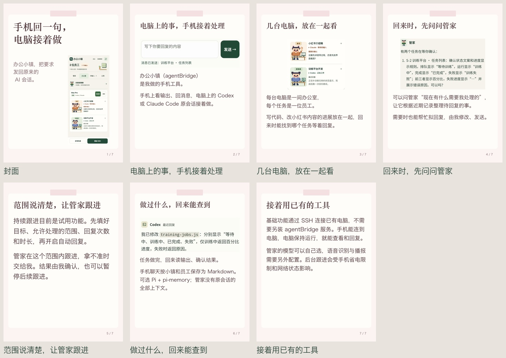
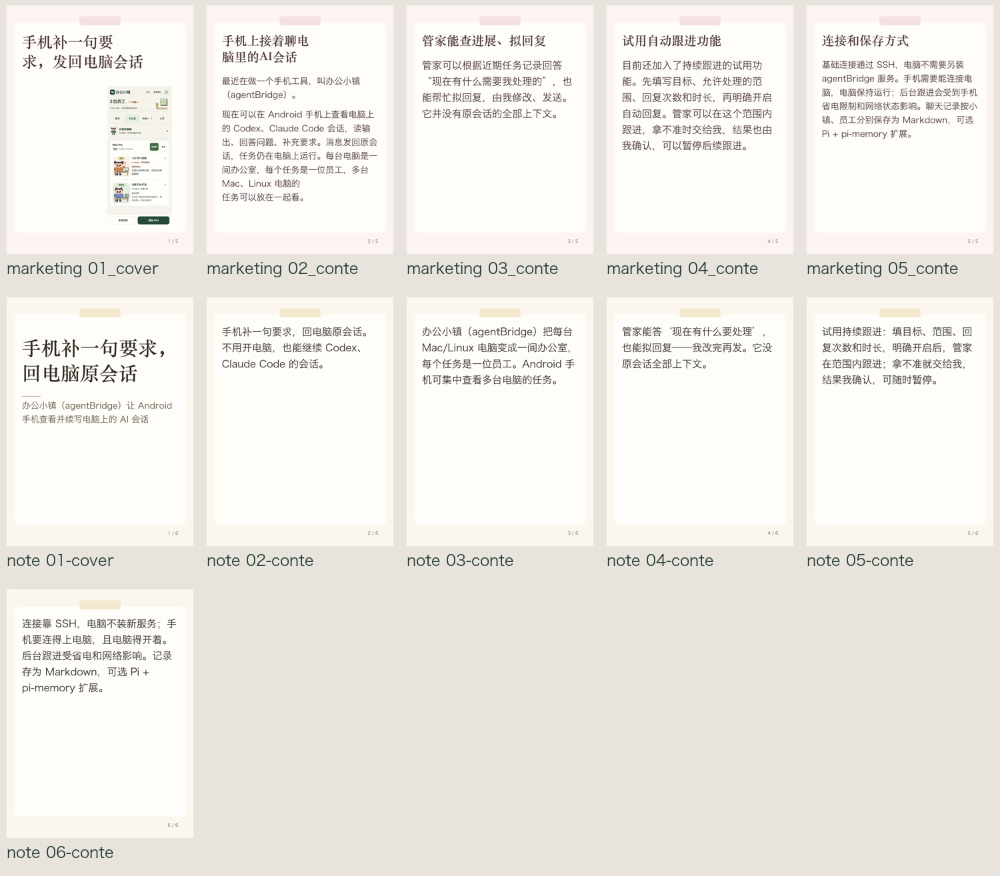

# 海报配图与文案调整 · 2026-10-11

本次改动在本地，尚未提交发布。

## 配图

在封面中心选择封面图片，也可以添加正文图片。正文列表按模型返回的正文段顺序配图，支持拖动排序、留空和移除。长文继续分页时，后续页不重复图片。重新生成文案后段落顺序可能改变，请在预览中检查图文对应关系。只提供封面图片不会自动把它复制到每个正文页。

竖版截图使用较大的侧栏布局，横版图和局部截图使用上图下文布局。原图保持比例，排版不会改写截图文字或自动裁剪界面。文字过多时继续生成阅读页。缺失的已选图片会报错，不把后面的图片挪过来顶替。外部背景和模板包保留原来的生成流程；正文配图用于默认样式及内置模板。

这七张图的文案由 Codex 根据当前项目能力人工整理，调用生产生成器输出；不能视为模型原样生成。图片来自 agentBridge 的既有演示截图，员工局部图来自当前 UI 的三倍分辨率演示渲染。未重新连接手机截图。管家持续跟进按试用功能介绍。

## 文案

默认提示词保留产品名，把查询、拟回复、持续跟进等不同操作分开讲。标题避免单字排列和“补会话”之类的缩写。素材明确写出“项目／工具叫某某”，生成结果遗漏名字时，补回素材里的原句，不编写新介绍。用户原有声明保留，模型自写的检查说明或重复产品名不放进声明区。

自动生成仍可能有别扭的句子，提示词不能保证每次都是成稿。下面保留同一份素材的实际模型结果，和人工整理示例分别展示。

本次模型为本机已有的阿里 qwen-plus，普通笔记和营销海报均成功生成。原始响应与经过产品名等核对后的结构分别保存，没有登录或发布小红书。主标题仍有偏长、拗口的情况，需要人工审阅。

## 检查

内置 25 款封面和正文、竖横版素材、教程、长文分页、旧稿、缩小尺寸完成本地检查。封面中心验证了添加图片、留空、移除、排序保存与重新加载，并检查 1050×870 窗口下的滚动操作。未实测 Windows、Linux 字体，也未测发布后表现或点击率。

最终 112 项相关测试通过（12.00 秒），git diff --check 通过。没有运行全项目网络或账号发布测试。
