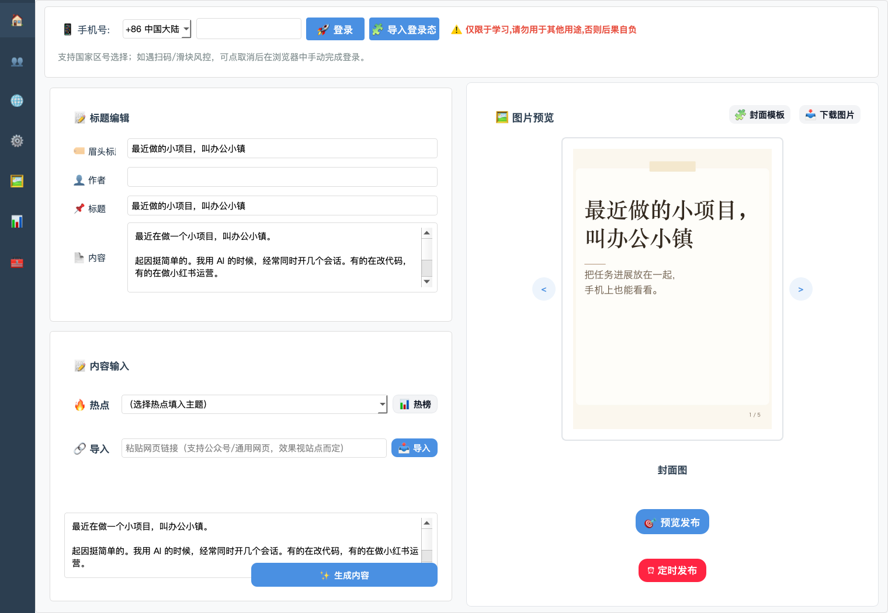
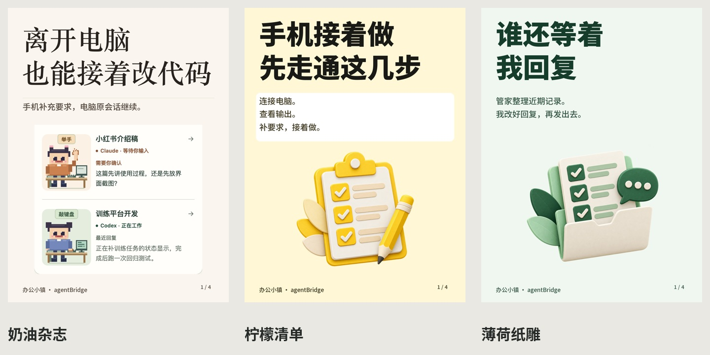
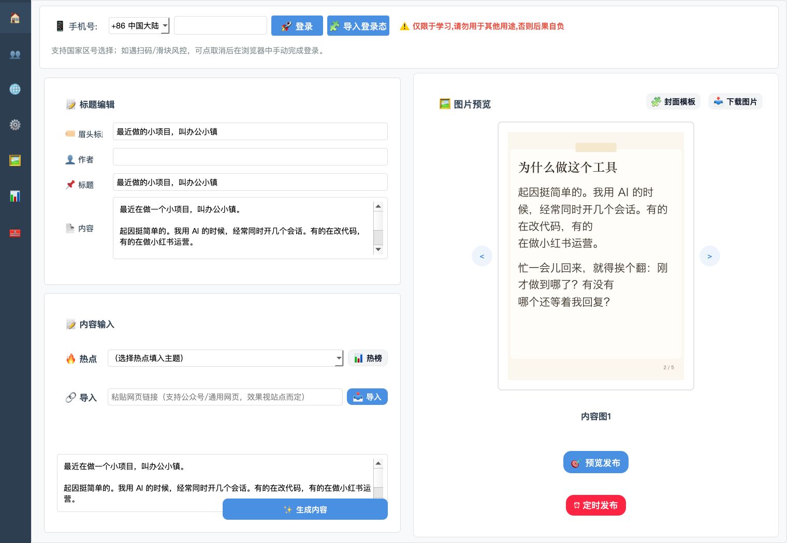
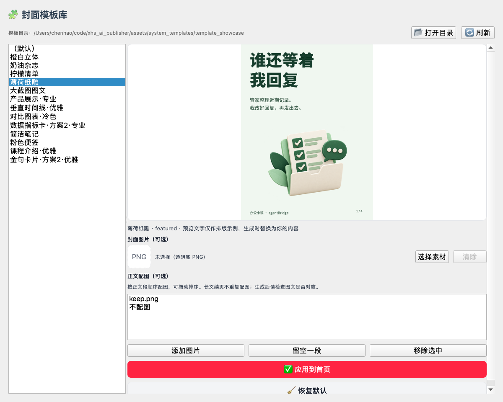
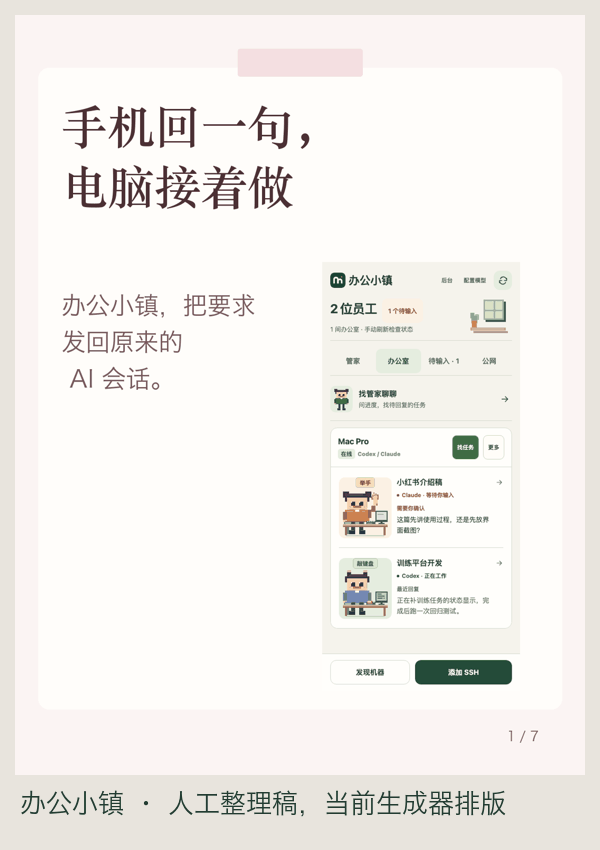
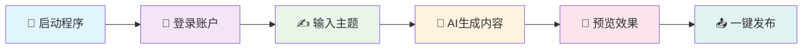

<div align="center">

<h1>🌟 小红书AI发布助手</h1>

   

<br/>

  

<br/><br/>

### 小红书笔记的本地编辑与发布工具

[🇨🇳 简体中文](./readme.md) | [🇺🇸 English](./readme_en.md)

<br/>



</div>

---

## v2.0.0-rc.2 改版预发布 · 2026-10-15

本次整合中文文案二次润色、13 款精选模板、多页图文排版和发布流程修复。预发布版用于验证新版功能，完整真实发布流程与各平台安装包仍需验收。

[版本下载与更新说明](https://github.com/BetaStreetOmnis/xhs_ai_publisher/releases/tag/v2.0.0-rc.2) · [验证结果与已知限制](docs/releases/v2.0.0-rc.2.md)

Web 服务默认仅本机访问，Docker 端口也绑定本机。远程访问必须设置 `XHS_WEB_API_TOKEN` 并通过 HTTPS 使用 `Authorization: Bearer <token>`；配置令牌后，本机 API 请求同样需要令牌。Web 页面可在“服务访问令牌”中填写，仅在当前页面内存中使用。使用反向代理或隧道时也必须设置令牌，不要依赖代理转发的客户端地址。

### 发布流程修复

- 定时发布失败后会暂停，后续任务也会停下，等核对结果后再安排。
- Web 发布改为排队执行；同一稿件或相同内容再次提交时会被拦住。排队期间改稿、图片失效或切换登录会话，任务会停止。
- 发布按钮只尝试点击一次。遇到弹窗或结果不明确时，留给用户核验。
- “审核中”和“已提交”分别记录，不再把页面跳转或“发布中”当作完成。
- 热点文案生成失败后停止任务，不再用固定模板继续发布；提交后也不会自动安排下一条热点。
- 程序重启后，中断的任务进入待核验；任务记录保存失败时，不会启动发布。

## 🆕 1.6号更新

- 📊 **热点数据**：内置微博/百度/头条/B站等热榜，支持一键带回首页生成内容
- 🪧 **新增营销模板**：在「🖼️ 封面中心」可选 **营销海报（本地排版，页数随内容调整）/ 促销横幅 / 产品展示** 等
- 🖼️ **预览/下载体验升级**：首页支持一键打开「封面模板库」，并一键下载 **封面 + 多页内容图**
- 🎨 **UI 体验优化**：左侧编辑、右侧图片预览，生成流程更顺滑

## 📖 项目简介

海报初稿现在按素材安排阅读页，不再默认拆成“痛点、亮点、适合人群”。封面优先写具体用途；正文保留原稿的操作、限制和后续计划。上传竖版截图后，图文版式会放大截图，保留完整界面。生成结果仍需要检查，模型可能误写功能或效果。

这是一个在电脑上写小红书笔记的工具。输入主题生成初稿，再改正文、选封面、做内容图，都可以在同一个界面里完成。模型和文案模板可以自己配置。默认文案按素材写，不强制凑字数或加收藏引导；测评需要实际体验记录。模型不可用时只预览原文。

生成初稿后，默认再用完整的 [humanizer-chinese](https://github.com/jiji262/humanizer-chinese) 规则单独改一遍正文，然后按阅读顺序生成内容图。普通笔记和海报共用这个步骤。在「后台配置 → AI模型配置」可以关闭，也可以贴一段自己的文字作为参考语气。这一步会多调用一次模型；格式或基础事实检查不通过时再试一次，仍不通过就提示并保留初稿。用法、规则来源和试写结果见[中文文案说明](docs/chinese-writing.md)。这些检查只能拦住部分问题，生成稿仍需要核对。

封面中心可以添加封面图片和正文配图。正文图片按段落顺序排列，可拖动调整，也能留空；长文续页不重复配图。竖版截图会放大展示并保留完整界面，文字过长时接着分页。产品介绍会保留素材中明确提供的产品名，模型初稿仍需检查。

封面中心现在保留 13 款模板，新加了「奶油杂志」「柠檬清单」「薄荷纸雕」。奶油款给产品截图留出大块位置，柠檬款适合写步骤和清单，薄荷款用绿色纸雕配粗体标题。原来的橙白立体、大截图图文也可以直接在列表里选，点「应用到首页」后生成。



颜色重复、版式用途相近的 17 款旧模板从列表里撤下。原文件仍保留，旧稿可以继续使用；打开封面中心时，旧选择会切到保留的相近模板，配图设置保留。自己导入的模板不受这次整理影响。

封面和内容页用自己的文字重新排版，长文接着分页。可以换成自己的封面图片和正文截图，图片保持比例，续页不重复配图。这里的文案是人工整理的办公小镇示例，配图来自已有 APP 演示素材，没有重新执行截图里的任务。具体选择和素材来源见[模板说明](docs/poster-layouts.md)。

它也能帮你填写发布页面，支持定时任务和本机 Web/API。发布这块还有几个没修好的问题，建议先拿来写稿和预览，最后到小红书确认发布。详情见[使用限制与已知问题](#使用限制与已知问题)。

---

## 界面与生成效果

正文配图、产品名保留及最新生成效果见[本次改动与实测](docs/poster-refinement-20261011.md)。

这次还用同一份素材实测了文案和海报生成，原始输出、人工审稿和排版对比放在[生成质量检查记录](docs/generation-quality-audit-20261011.md)。自动初稿仍需审阅。

下面是 2026-10-11 本地版本的界面，编辑区放的是“办公小镇”的介绍稿，用来展示排版，没有提交到小红书。

左边放素材、改正文，右边翻看封面和内容图。



在封面中心选择版式，预览中的示例文字会在生成时换成自己的内容。



下面用“办公小镇”做例子，轮播当前保留的 13 款模板，每张停留约 3 秒。


下面的七张图用办公小镇做例子：手机回复、集中看任务、问管家、持续跟进、查记录和连接方式。文案经过人工整理，图片由当前生成器排版，使用已有的 APP 演示截图及局部截图。持续跟进按试用功能介绍。



[查看 13 款精选模板](./docs/assets/poster-gallery-curated-20261012.jpg) · [查看图文静态总览](./docs/assets/poster-set-20261011.jpg)

---

## ✨ 核心功能

<table>
<tr>
<td width="50%">

### 🤖 AI智能生成
- 🎯 **智能标题**: AI生成吸引人的标题
- 📝 **内容创作**: 基于主题自动生成文章
- 🔧 **自定义模型**: 支持配置 OpenAI 兼容/Claude/Ollama 等接口用于内容生成（未配置则回退到内置方案）
- 🧩 **文案模板**: 支持选择不同风格的提示词模板（`templates/prompts/*.json`），可自行扩展
- 📊 **热点采集**: 内置微博/百度/头条/B站等热榜，一键带回首页生成内容
- 🔗 **网页链接导入**: 粘贴网页链接导入标题/正文/图片（支持公众号/通用网页；效果视站点而定）
- 🖼️ **图片处理**: 智能匹配和处理图片
- 🖼️ **封面/内容图模板**: 支持在「🖼️ 封面中心」选择模板（含橙白立体、奶油杂志、柠檬清单、薄荷纸雕和产品展示等），生成时自动输出封面 + 多页内容图（可一键下载）
- 🏷️ **标签推荐**: 自动推荐热门标签

</td>
<td width="50%">

### 🚀 自动化发布
- 📱 **一键登录**: 支持手机号快速登录，支持国家区号选择；如遇风控可切换手动完成登录
- 🧩 **导入登录态**: 支持从系统 Chrome 导入小红书登录态（适用于短信/扫码风控后的登录复用）
- 📋 **内容预览**: 发布前完整预览效果
- ⏰ **定时发布**: 支持任务管理与到点执行，需保持程序运行且账号已登录；当前不建议无人值守使用，见[使用限制与已知问题](#使用限制与已知问题)
- 💾 **状态保存**: 自动保存登录状态

</td>
</tr>
<tr>
<td width="50%">

### 👥 用户管理
- 🔄 **多账户/用户管理**: 支持新增/切换/删除用户；登录态与数据按用户隔离
- 🗂️ **本地数据**: 用户/环境/配置/日志均落地本地（`~/.xhs_system/`）

</td>
<td width="50%">

### 🛡️ 本地存储与日志
- 🔐 **数据加密**: 模型 API Key 默认本地加密存储（`~/.xhs_system/keys.enc`）
- 📝 **日志记录**: 记录操作与错误，便于核对问题
- 🔄 **失败处理**: 失败后进入待核验并暂停后续定时任务，不会自动重发

</td>
</tr>
</table>

---

## 在手机上让 Codex 操作小红书工具

手机用[办公小镇（agentBridge）](https://github.com/otterview-labs/agentBridge)接着给 Mac 上的 Codex 发消息，让它写稿、改稿、保存草稿。小红书工具和 Codex 都在 Mac 上运行，手机不用直接连接小红书服务。

目前建议先在手机看文案，图片另行查看，再到小红书页面核对账号并确认发布。手机授权自动发布也有下面的[已知风险](#使用限制与已知问题)，接口返回成功不代表笔记通过了审核。

普通管家聊天目前只查任务，实际操作由 Codex 完成。这条手机到发布的完整流程还没做完实机验收，手机聊天也没有专门的草稿和图片预览页面。

[配置方法与 Codex 操作说明](docs/codex-mobile.zh.md) · [了解办公小镇](https://github.com/otterview-labs/agentBridge) · [看 App 操作视频](https://otterview-labs.github.io/agentBridge/?from=xhs-readme#demo)

---

## 使用限制与已知问题

用这套工具发笔记，仍然可能被限流、禁言或封号。

目前建议这样用：

- 先拿它写草稿、做图片。没用过的产品、没去过的地方，不要让模型写成“亲测”；涉及事实的内容，查过来源再发。
- 到小红书 App 或创作中心核对正文、图片和目标账号，再自己确认发布。先不要开无人值守的连续发帖，也不要让 AI 批量代发或代替你互动。
- 用了 AI 生成的内容，按平台要求做声明。声明不能代替事实核对，手动点发布也不是账号安全的保证。
- 发布超时，先去小红书看看笔记是否已经提交。出现异常或违规提示，就停下发布和定时任务，查看通知、核对原因，必要时通过平台申诉。

小红书已有[关于 AI 托管账号的公告（IT之家全文转述）](https://www.ithome.com/0/927/689.htm)，也明确提醒不要用 AI 编造体验或伪造实景，见[薯管家公告](https://weibo.com/2/detail/5339140690281632)。本机运行、换成手机操作，或让 Codex 来调用，都不能据此认为发布方式已获平台认可。

<details>
<summary>改了哪些，还有哪些没做</summary>

原评估版本：[dc766ff](https://github.com/BetaStreetOmnis/xhs_ai_publisher/commit/dc766ff8151c7a6a7ce4dce90f9bf40562a07f06)。下面 6 项发布流程修复纳入 `v2.0.0-rc.2`，另补充 Web 访问保护。

| 问题 | 进度 | 现在的处理方式 |
| --- | --- | --- |
| [结果不确定时仍重试](src/core/scheduler/schedule_manager.py#L322) | 已修复 | 失败后进入待核验，暂停后续定时任务，不再 10 分钟后重发。核验后需重新安排任务。 |
| [Web 发布没有排队和去重](src/web/app.py#L444) | 已修复 | 发布逐个执行，重复稿件和相同内容的请求会被拦住。排队期间改稿、图片失效或登录会话变化，也会停止发送。当前只支持单个 Web worker。 |
| [发布状态判断不准](src/core/write_xiaohongshu.py#L1643) | 已修复 | “审核中”记录为审核中，成功提示只记为已提交。页面跳转和“发布中”不会当成完成，仍需到平台确认审核结果。 |
| [弹窗会被自动确认](src/core/write_xiaohongshu.py#L1635) | 已修复 | 发现发布弹窗就停下，交给用户处理。发布按钮尝试点击后，超时也不会换个按钮再点。 |
| [生成失败后还会发模板稿](src/core/browser.py#L445) | 已修复 | 热点文案生成失败就暂停，不再套固定内容继续发。提交后也不会按热点间隔自动滚动发布下一条。 |
| [重启后任务可能卡住](src/core/scheduler/schedule_manager.py#L131) | 已修复 | 中断的定时任务和 Web 发布任务改为待核验，不会直接重发。任务记录改为先写临时文件再替换，写入失败不会启动发送。 |
| Web 接口调用者验证 | 已增加 | 默认仅本机访问；远程调用必须设置访问令牌。配置令牌后所有 API 请求均需 Bearer 认证；浏览器跨来源请求被拒绝。 |
| 部分旧测试不匹配当前接口 | 部分处理 | 已替换失效的内容测试并隔离运行数据；192 项维护中的离线测试通过。完整非浏览器测试仍有 17 项失败，详见版本说明。 |

这些修复没有解决内容真实性和平台规则的问题。真实经历、事实来源、图片和 AI 声明仍需要你在发布前核对；真实页面的完整发布流程还要验收。

[Issue #29](https://github.com/BetaStreetOmnis/xhs_ai_publisher/issues/29)有人反馈“被检测了”。缺少完整处罚通知、使用版本和发布日志，还不能确定具体原因，更不能据此承诺修完就不会受处罚。

</details>

---

## 📁 项目架构

```
📦 xhs_ai_publisher/
├── 📂 assets/                       # 🧩 内置系统模板预览（可选）
├── 📂 templates/                    # 🧩 文案/封面模板（可自行扩展）
├── 🧰 install.sh                    # 📦 一键安装（macOS/Linux）
├── 🧰 install.bat                   # 📦 一键安装（Windows）
├── 📂 src/                          # 🔧 源代码目录
│   ├── 📂 core/                     # ⚡ 核心功能模块
│   │   ├── 📂 models/               # 🗄️ 数据模型
│   │   ├── 📂 services/             # 🔧 业务服务层
│   │   ├── 📂 pages/                # 🎨 界面页面
│   │   ├── 📂 processor/            # 🧩 内容/图片处理
│   │   ├── 📂 scheduler/            # ⏰ 定时任务（到点自动发布）
│   │   └── 📂 ai_integration/       # 🤖 AI适配（实验）
│   ├── 📂 web/                      # 🌐 Web接口
│   │   ├── 📂 templates/            # 📄 HTML模板
│   │   └── 📂 static/               # 🎨 静态资源
│   └── 📂 logger/                   # 📝 日志系统
├── 📂 images/                       # 🖼️ 文档/界面截图资源
├── 📂 docs/                         # 📚 文档
├── 📂 tests/                        # 🧪 测试目录
├── 📂 venv/                         # 🐍 本地虚拟环境（已在 .gitignore，不会上传 GitHub）
├── 🐍 main.py                       # 🚀 主程序入口
├── 🚀 启动程序.sh                   # ▶️ 启动脚本（macOS/Linux）
├── 🚀 启动程序.bat                  # ▶️ 启动脚本（Windows）
├── ⚙️ .env.example                  # 🔑 环境变量示例（不要提交真实 .env）
├── 📋 requirements.txt              # 📦 依赖包列表
└── 📖 readme.md                     # 📚 项目说明
```

---

## 🛠️ 快速开始

### 📋 系统要求

<div align="center">

| 组件 | 版本要求 | 说明 |
|:---:|:---:|:---:|
| 🐍 **Python** | `3.10–3.12` | 推荐使用 Python 3.11/3.12 |
| 🌐 **Chrome** | `最新版` | 用于浏览器自动化 |
| 💾 **内存** | `4GB+` | 推荐8GB以上 |
| 💿 **磁盘** | `2GB+` | 用于存储依赖和数据 |

</div>

> Windows 建议使用 **Python 3.11/3.12（64 位）**；Python 3.13 或 32 位 Python 常见会导致 **PyQt5 安装失败**。

### 🚀 安装方式

#### 🎯 一键安装（推荐）

| 操作系统 | 安装脚本 | 启动脚本 |
|:---:|:---:|:---:|
| macOS / Linux | `./install.sh` | `./启动程序.sh` |
| Windows | `install.bat` | `启动程序.bat` |

```bash
# macOS/Linux
chmod +x install.sh 启动程序.sh
./install.sh
./启动程序.sh
```

> `./启动程序.sh` 会优先使用 `venv/bin/python`；若虚拟环境解释器缺失、软链失效或环境损坏，会自动回退到系统 `python3` / `python`，不会写死机器路径。

```bat
:: Windows
install.bat
启动程序.bat
```

> 默认会检测 Playwright 浏览器并在缺失时自动安装；可用参数：
> - 强制安装：`./install.sh --with-browser` / `install.bat --with-browser`
> - 跳过浏览器：`./install.sh --skip-browser` / `install.bat --skip-browser`
> - Windows 双击 `启动程序.bat` / `install.bat` 失败时，现在会保留报错窗口，方便定位问题

#### 🧩 登录工具 + 服务模式（参考社区常见做法）

参考 `xiaohongshu-mcp`、`xhs-toolkit` 这类项目的思路，当前仓库也支持：
- **先在可视化环境完成一次登录，保存登录态**
- **再由 Web/API 服务或 Docker 无头复用该登录态执行发布**

本地获取登录态：

```bash
python scripts/xhs_login_cli.py --phone 13800138000 --country-code +86
```

说明：
- 该命令会打开浏览器并尽量复用/保存 `storage_state + cookies`
- 若命中验证码/扫码/滑块风控，可按提示在浏览器中手动完成
- 成功后，登录态默认保存在 `~/.xhs_system/`（或 `XHS_DATA_DIR` 指定目录）
- 当本地 `storage_state/cookies` 失效时，登录流程会自动尝试扫描系统 Chrome 的多个 Profile，识别可用的小红书登录态并导入；可用 `XHS_AUTO_IMPORT_SYSTEM_CHROME_STATE=false` 关闭
- 使用真实 Chrome 持久化 Profile 时，默认不再注入额外 stealth 指纹覆写；如确有需要可设置 `XHS_ENABLE_STEALTH_SCRIPT=true`
- 自动发布默认禁用 JS 强制点击/强制 input/change 兜底；仅手动确认模式或显式设置 `XHS_ENABLE_FORCE_DOM_ACTIONS=true` 时才启用
- 若系统 Chrome 正在运行，自动识别登录态会默认跳过，避免额外弹出多窗口；需要手动导入时再显式操作

#### 🐳 Docker 部署（推荐 Web/API 模式）

> 桌面版 `PyQt` 不适合直接做容器 GUI 部署；**容器里推荐运行 `FastAPI + Playwright` 服务模式**。

```bash
docker compose build
docker compose up -d
```

默认暴露：
- Web/API：`http://localhost:8000`
- 健康检查：`http://localhost:8000/healthz`
- 就绪检查：`http://localhost:8000/readyz`

服务优化说明：
- 现在 Web/Docker 模式默认采用 **懒加载浏览器运行时**
- 服务启动时只初始化基础管理器，不会立刻拉起 Playwright 浏览器
- 第一次调用登录/发布接口时，才按需初始化浏览器运行时
- 如需启动即预热浏览器，可设置 `XHS_WEB_EAGER_BROWSER=true`

容器部署建议流程：
1. 先在本机可视化环境执行一次 `python scripts/xhs_login_cli.py ...` 获取登录态
2. 将登录态目录挂载到容器的 `/data`（本仓库默认映射 `./docker-data:/data`）
3. 再以无头模式运行容器服务进行发布

注意：
- 默认 Docker 端口映射为 `127.0.0.1:8000:8000`。Docker 网络内的调用也需要设置 `XHS_WEB_API_TOKEN`；远程访问、反向代理或隧道必须使用令牌和 HTTPS。小红书登录状态不能代替服务访问认证。
- 默认 `docker-compose.yml` 中启用了 `XHS_HEADLESS=true`
- 如果当前登录态失效，无头模式不会弹验证码窗口，而会明确提示需要先在有界面环境重新登录
- `docker compose ps` 可直接看到健康状态；健康检查依赖 `/healthz`

#### 📥 手动安装（高级用户）

```bash
# 1️⃣ 创建虚拟环境
python -m venv venv

# 2️⃣ 激活虚拟环境（macOS/Linux）
source venv/bin/activate

# 3️⃣ 安装依赖
pip install -r requirements.txt

# 4️⃣ （可选）安装 Playwright Chromium
PLAYWRIGHT_BROWSERS_PATH="$HOME/.xhs_system/ms-playwright" python -m playwright install chromium

# 5️⃣ 启动程序（首次启动会自动初始化数据库）
./启动程序.sh
```

> `./启动程序.sh` 会自动检测可用 Python；如果本地 `venv/bin/python` 已损坏，也会回退到系统 Python 启动，并提示你后续可用 `./install.sh` 修复环境。

提示：
- 运行数据默认存放于 `~/.xhs_system/`（数据库、日志、浏览器缓存等）
- 也可通过 `XHS_DATA_DIR=/your/path` 改为自定义目录（Docker/服务模式推荐）

常见问题：
- Windows 安装失败（多为 PyQt5）：请用 Python 3.11/3.12（64 位），避免 Python 3.13 或 32 位 Python
- Linux 浏览器启动失败：可能缺少系统依赖，执行 `sudo python -m playwright install-deps chromium`（或对应发行版命令）
- `qt.qpa.fonts ... Microsoft YaHei`：Qt 的字体告警，可忽略；当前版本已改为自动选择系统可用字体
- 内容页个别符号显示“方框/叉号”：通常是系统字体不支持该字符（emoji/圈数字/信息符号等）；建议减少特殊符号，或更换/安装字体（程序也会做一部分字符清理/替换）

---

## 📱 使用指南

### 🎯 基础使用流程

<div align="center">



</div>

### 📝 详细步骤

1. **🚀 启动程序**
   - 运行 `./启动程序.sh` 或 `python main.py`
   - 等待程序加载完成
	
2. **👥 用户管理（可选）**
   - 侧边栏「👥」支持新增/切换/删除用户
   - 登录态、浏览器环境、cookie/token 等数据按用户隔离

3. **🌐 浏览器环境（可选）**
   - 侧边栏「🌐」创建环境，并可设置“⭐ 默认环境”
   - 默认环境的代理/基础指纹会应用到发布会话（UA/viewport/locale/timezone/geolocation 等）

4. **📊 数据中心（可选）**
   - 侧边栏「📊」查看多平台热榜
   - 选中热点后点击「✍️ 用作首页主题」一键带回首页生成

5. **🖼️ 封面模板（可选）**
   - 侧边栏「🖼️」进入封面中心选择模板，并「✅ 应用到首页」
   - 也可在首页右侧预览区点击「🧩 封面模板」快速跳转

6. **📱 账户登录**
   - 选择国家区号并输入手机号码
   - 接收并输入验证码；如遇扫码/滑块风控，可取消输入后在浏览器中手动完成登录
   - 系统自动保存登录状态；若本地登录态失效，会自动尝试从系统 Chrome Profile 识别并导入可用登录态
   - 如需手动指定/强制导入：可点击「🧩 导入登录态」从系统 Chrome 导入（建议先完全退出 Chrome，避免 Profile 被占用）

7. **🔗 网页链接导入（可选）**
   - 首页「🔗 导入」粘贴网页链接
   - 点击「📥 导入」自动抓取标题/正文/图片并填充到草稿（效果视站点而定）

8. **✍️ 内容创作**
   - 在主题输入框输入创作主题
   - 点击"生成内容"按钮
   - AI自动生成标题和内容

9. **🖼️ 图片处理**
   - 系统自动匹配相关图片
   - 可手动上传自定义图片
   - 支持多图片批量处理

10. **👀 预览发布**
   - 点击"预览发布"查看效果
   - 确认内容无误后点击发布
   - 或点击「⏰ 定时发布」设置时间，到点自动发布（需保持程序运行且账号已登录）

---

## 🤖 自定义模型与模板

- 入口：侧边栏「⚙️ 后台配置」→「AI模型配置」
- API Key：保存时默认加密写入 `~/.xhs_system/keys.enc`（`settings.json` 不再明文保存）
- Kimi：普通开放平台选择「月之暗面（Kimi）」和 `kimi-k3`；会员套餐选择「Kimi Code（会员套餐）」和 `k3-256k`。两种 Key、地址和额度分开使用。Kimi Code 可复用本机 Claude Code 中同一服务地址的凭据，程序使用自己的客户端标识。
- K3 会先思考再返回正文。首次切换时预设 8192 Token、180 秒超时；输出被截断会提示错误，不作为完整文案使用。独立润色还会增加模型调用。
- 文案模板：在「文案模板」下拉框选择；模板文件位于 `templates/prompts/`
- 系统图片模板：侧边栏「⚙️ 后台配置」→「模板库」可选择/导入（将外部模板导入到 `~/.xhs_system/system_templates`，便于跨平台使用）
- 封面模板：侧边栏「🖼️ 封面中心」选择并应用到首页；生成图片默认缓存于 `~/.xhs_system/generated_imgs/`，可在首页「📥 下载图片」导出

### ⚙️ 通过 `.env` 配置模型（可选，推荐 OpenAI-compatible）

> `.env` 已在 `.gitignore`，不会推送到 GitHub；请勿把真实 key 写进 `.env.example`。

```bash
cp .env.example .env
```

说明：
- 默认优先使用 UI「AI模型配置」里的设置；仅当 UI 未配置时才会使用 `.env` 作为兜底
- 如需强制使用 `.env`，将 `XHS_LLM_OVERRIDE=true`
- `XHS_LLM_BASE_URL` 可填 base_url（如 `.../v1`、`.../api/paas/v4`）或完整的 `.../chat/completions`（程序会自动补全）

以智谱 GLM-5 为例（OpenAI-compatible）：

```bash
XHS_LLM_BASE_URL=https://open.bigmodel.cn/api/paas/v4
XHS_LLM_MODEL=glm-5
XHS_LLM_API_KEY=你的key

# 可选：强制使用环境变量（即使 UI 已配置）
XHS_LLM_OVERRIDE=true

# 可选：GLM-5 建议给大一点
XHS_LLM_TIMEOUT=120
XHS_LLM_MAX_TOKENS=3200
```

图片排版风格（可选）：

```bash
XHS_IMG_SHOW_TAGS=false
XHS_IMG_SHOW_CONTENT_CARD=false
XHS_IMG_BOXED_LIST_CARDS=false
```

## 🔧 高级配置

### 📁 数据与配置位置

- `~/.xhs_system/settings.json`：应用配置（手机号/标题/模型/模板等）
- `~/.xhs_system/keys.enc`：模型 API Key 加密存储
- `~/.xhs_system/xhs_data.db`：本地数据库（用户/浏览器环境等）
- `~/.xhs_system/generated_imgs/`：生成图片缓存
- `~/.xhs_system/ms-playwright/`：Playwright 浏览器缓存目录
- `~/.xhs_system/logs/`：运行日志
- `~/.xhs_system/hotspots_cache.json`：热点缓存
- `~/.xhs_system/schedule_tasks.json`：定时发布任务

---

## 📊 开发路线图

<div align="center">

### 🗓️ 开发计划

</div>

- [x] ✅ **基础功能**: 内容生成和发布
- [x] ✅ **用户管理**: 多账户/当前用户切换/数据隔离
- [x] ✅ **模板库**: 文案模板 + 系统图片模板导入 + 封面模板库
- [x] ✅ **数据中心**: 多平台热榜采集 + 一键带回首页生成
- [x] ✅ **定时发布**: 支持任务管理与到点执行（需保持程序运行；失败后需人工核验，热点任务不再自动滚动发布）
- [ ] 🔄 **发布效果分析**: 数据统计/分析面板持续完善
- [ ] 🔄 **API接口**: 开放API接口

---

## 🤝 参与贡献

<div align="center">

**🎉 我们欢迎所有形式的贡献!**


</div>

### 🛠️ 贡献指南

1. 🍴 Fork 项目
2. 🌿 创建功能分支 (`git checkout -b feature/AmazingFeature`)
3. 💾 提交更改 (`git commit -m 'Add some AmazingFeature'`)
4. 📤 推送到分支 (`git push origin feature/AmazingFeature`)
5. 🔄 创建 Pull Request

---

## 📞 联系我们

<div align="center">

### 💬 加入我们的社区

<table>
<tr>
<td align="center">

<br/>
<strong>🐱 微信群</strong>
<br/>
<em>扫码加入讨论</em>
</td>
<td align="center">

<br/>
<strong>📱 公众号</strong>
<br/>
<em>获取最新动态</em>
</td>
</tr>
</table>

<br/>


</div>

---

## ⭐ Star 历史

[](https://star-history.com/#betastreetomnis/xhs_ai_publisher&Date)

---

## 📄 许可证

<div align="center">

本项目采用 **Apache 2.0** 许可证 - 查看 [LICENSE](LICENSE) 文件了解详情

<br/>


<br/><br/>

---

<sub>🌟 为小红书内容创作者精心打造 | Built with ❤️ for Xiaohongshu content creators</sub>

<br/>

**⭐ 如果这个项目对您有帮助，请给我们一个星标!**

</div>

