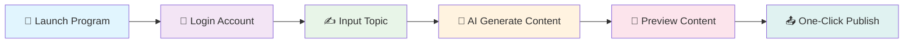

# 🌟 Xiaohongshu AI Publisher

<div align="center">


<br/>


<br/><br/>

<h3>A desktop tool for writing and publishing Xiaohongshu posts</h3>

[🇨🇳 简体中文](./readme.md) | [🇺🇸 English](./readme_en.md)

<br/>


</div>

---

## v2.0.0-rc.1 redesign pre-release · 2026-10-15

This pre-release brings together Chinese editing, 13 curated templates, multi-page image layouts and publication fixes. It is intended for validation; the full real-account publication flow and platform packages still need acceptance testing.

[Downloads and release notes](https://github.com/BetaStreetOmnis/xhs_ai_publisher/releases/tag/v2.0.0-rc.1) · [Validation and known limits](docs/releases/v2.0.0-rc.1.md)

Web access and the Docker host port default to loopback. Remote access requires `XHS_WEB_API_TOKEN` and HTTPS, with `Authorization: Bearer <token>`. Once a token is configured, local API calls also require it. Enter the token in the Web page's service-token field; it stays in page memory. Set a token behind reverse proxies and tunnels too; do not rely on the proxy's client address.

### Publication fixes

- Failed scheduled publications pause the queue. Check the result before arranging another task.
- Web publications run one at a time. Repeat submissions of the same post or identical content are rejected. Changes to queued text, missing images or a changed login session stop the task.
- The publish button is attempted once. Dialogs and uncertain results require user verification.
- “Under review” and “submitted” are recorded separately. URL changes and “publishing” no longer count as completion.
- Failed hotspot text generation stops the task without publishing fallback text. Submission does not automatically schedule another hotspot post.
- Interrupted tasks require verification after a restart. Failed record writes prevent publication from starting.

## 🆕 Jan 6 Update

- 📊 **Hotspot data**: built-in hot lists (Weibo/Baidu/Toutiao/Bilibili), one-click to use as the homepage topic
- 🪧 **New marketing templates**: pick **Marketing Poster (local layout; page count follows the content) / Promo Banner / Product Showcase** in “🖼️ Cover Center”
- 🖼️ **Preview & download improvements**: open the cover template library and download **cover + content images** directly from the homepage
- 🎨 **UI flow improvements**: left-side editing with right-side image preview

## 📖 Project Overview

A desktop tool for writing Xiaohongshu posts. Enter a topic to generate a draft, then edit the text, choose a cover and create content images in the same interface. You can configure your own model and writing templates. Default prompts follow the supplied material without a minimum word count or a forced engagement ending. Reviews need actual experience notes. If the model is unavailable, the tool previews the original text.

After drafting, Chinese generation uses the full [humanizer-chinese](https://github.com/jiji262/humanizer-chinese) rules in a separate editing request, then creates content pages from the edited text. This is enabled by default for notes and posters. In Backend Config → AI Model, you can disable it or paste a writing sample to guide the tone. Editing adds one model call, with one retry if the format or basic fact checks fail. If both attempts fail, the app keeps the draft and shows a message. These checks only catch some problems; review generated text before use. See the [Chinese writing notes](docs/chinese-writing.md) for usage, attribution and examples.

New poster drafts follow the supplied material rather than a fixed pain-points/features/audience outline. Covers lead with a concrete use; the body keeps actual operations, limitations and future plans. Portrait screenshots are shown larger without cropping their UI. Review every draft: the model can still misstate features or results.

Add a cover image and ordered body images in Cover Center. Drag body images to reorder them or leave an empty slot. Overflow text continues on another page without repeating the image. Portrait screenshots are displayed larger without cropping their UI. Product introductions retain names explicitly supplied in the source; review every generated draft.

Cover Center now offers 13 selected templates. Three are new: “奶油杂志” (Cream Editorial), “柠檬清单” (Lemon Checklist) and “薄荷纸雕” (Mint Paper). Cream Editorial gives screenshots more space; Lemon Checklist suits steps and lists; Mint Paper pairs green paper illustrations with bold titles. Orange Paper and Screenshot Story are also direct choices in the list. Select a template and click “应用到首页” (Apply to Home) before generating.


Seventeen older choices with similar colors or overlapping uses have been removed from the list. Their files remain available for older drafts. Opening Cover Center maps a retired selection to a retained choice while keeping your image settings. Imported templates are unaffected.

The renderer typesets your own copy for covers and content pages. Long text continues on another page; imported images keep their aspect ratios and do not repeat on overflow pages. These previews use manually prepared Office Town copy and existing app demo images. They do not show newly executed tasks. See the [template guide and asset sources](docs/poster-layouts.md).

It can also fill the publication form, run scheduled tasks and accept local Web/API calls. Publication still has unresolved problems. Start with drafts and previews, then confirm publication on Xiaohongshu. See [usage limits and known issues](#usage-limits-and-known-issues).

---

## Interface and generated images

See the [latest changes and generation checks](docs/poster-refinement-20261011.md) for ordered body images, product-name retention and current results.

We also tested note and poster generation with the same source. The [generation quality audit](docs/generation-quality-audit-20261011.md) keeps original model outputs separate from the edited draft and layout comparison. Review automatic drafts before use.

Screenshots below show the Chinese desktop UI from the local build on October 11, 2026. The editor contains an Office Town introduction to demonstrate editing and layout; it was not submitted to Xiaohongshu.

Edit the source and draft on the left, then browse the cover and content images on the right.


Choose a layout in the cover library. Sample text in the preview is replaced with your own content when generating images.


The preview uses Office Town (agentBridge) and cycles through the 13 selected templates, showing each for about 3 seconds.


The seven-image Office Town example covers phone replies, task overview, butler queries, scoped follow-up, history and connection setup. The copy was manually edited and rendered by the current generator using existing app demo screenshots and crops. Follow-up is described as a trial feature.


[View the 13 selected templates](./docs/assets/poster-gallery-curated-20261012.jpg) · [View the illustrated example](./docs/assets/poster-set-20261011.jpg)

---

## ✨ Core Features

<table>
<tr>
<td width="50%">

### 🤖 AI Smart Generation
- 🎯 **Smart Titles**: AI-generated engaging titles
- 📝 **Content Creation**: Auto-generate articles based on topics
- 🔧 **Custom Models**: Configure OpenAI-compatible / Claude / Ollama endpoints for generation (falls back to built-in methods if not configured)
- 🧩 **Prompt Templates**: Choose different writing styles via templates (`templates/prompts/*.json`), and extend them easily
- 📊 **Hotspot Center**: Built-in hot lists (Weibo/Baidu/Toutiao/Bilibili), one-click to use as homepage topic
- 🔗 **Web Link Import**: Paste a link to import title/content/images (WeChat articles + generic webpages; results depend on the site)
- 🖼️ **Image Processing**: Smart image matching and processing
- 🖼️ **Cover/Content Templates**: Choose a template in “🖼️ Cover Center” (including Orange Paper, Cream Editorial, Lemon Checklist, Mint Paper and Product Showcase); generation outputs a cover + multiple content images (one-click download)
- 🏷️ **Tag Recommendations**: Auto-recommend trending tags

</td>
<td width="50%">

### 🚀 Automated Publishing
- 📱 **One-Click Login**: Quick login with phone number, country-code selection, and manual browser completion when risk control is triggered
- 🧩 **Import Login State**: Import Xiaohongshu login state from your system Chrome (useful for SMS/QR risk-control flows)
- 📋 **Content Preview**: Complete preview before publishing
- ⏰ **Scheduled Publishing**: Manage tasks and run them at the scheduled time while the app is running and the account is signed in. Unattended use is currently not recommended; see [usage limits and known issues](#usage-limits-and-known-issues).
- 💾 **State Saving**: Auto-save login status

</td>
</tr>
<tr>
<td width="50%">

### 👥 User Management
- 🔄 **Multi-Account / Users**: Create/switch/delete users; login/session data is isolated per user
- 🗂️ **Local Storage**: Users/environments/config/logs are stored locally under `~/.xhs_system/`

</td>
<td width="50%">

### 🛡️ Local Storage & Logs
- 🔐 **Data Encryption**: Model API keys are stored locally with encryption by default (`~/.xhs_system/keys.enc`)
- 📝 **Logging**: Record operations and errors for troubleshooting
- 🔄 **Failure Handling**: Failures require verification and pause following scheduled tasks; there is no automatic retry.

</td>
</tr>
</table>

---

## Use Xiaohongshu AI Publisher from your phone with Codex

Use [Office Town (agentBridge)](https://github.com/otterview-labs/agentBridge/blob/main/README.en.md) to continue your Mac's Codex session from your phone. Ask it to write, revise and save drafts. Both Codex and this tool run on the Mac; your phone does not need direct access to the Xiaohongshu service.

For now, review text on your phone and view images separately, then check the account and confirm publication on Xiaohongshu. Authorizing automatic publication from your phone carries the [known risks below](#usage-limits-and-known-issues). A successful API result does not mean a post passed moderation.

Ordinary butler chat currently queries tasks; Codex performs the operations. The complete phone-to-publication workflow has not passed physical-device verification, and phone chat has no dedicated draft or image preview screen.

[Setup and instructions for Codex](docs/codex-mobile.en.md) · [Read the English README](https://github.com/otterview-labs/agentBridge/blob/main/README.en.md) · [Watch the English app demo](https://otterview-labs.github.io/agentBridge/en/?from=xhs-readme-en#demo) · [Download the English video](https://github.com/otterview-labs/agentBridge/releases/download/android-v0.5.53/office-town-mobile-en-landscape.mp4)

---

## Usage limits and known issues

Posts can still be restricted, and accounts can still be muted or banned when using this tool.

For now:

- Use the tool to write drafts and prepare images. Do not turn products you have never used or places you have never visited into personal-experience claims. Check factual sources before posting.
- Review the text, images and target account in the Xiaohongshu app or creator center, then publish yourself. Avoid unattended posting, bulk AI publication and automated interactions.
- Declare AI-generated content as the platform requires. A declaration does not replace fact checking, and a manual publication click does not guarantee account safety.
- After a timeout, check Xiaohongshu for an existing submission before trying again. Stop publication and scheduled tasks when an account warning or violation notice appears. Read the notice and use the platform's appeal process if needed.

Xiaohongshu has published a notice about AI-managed accounts ([full text reproduced by IT Home](https://www.ithome.com/0/927/689.htm)) and warns against fabricated experiences and fake real-world images ([official notice](https://weibo.com/2/detail/5339140690281632)). Running locally, using a phone or calling through Codex does not establish platform approval for the publication method.

<details>
<summary>What has changed and what remains</summary>

Original reviewed revision: [dc766ff](https://github.com/BetaStreetOmnis/xhs_ai_publisher/commit/dc766ff8151c7a6a7ce4dce90f9bf40562a07f06). The six publication fixes below are included in `v2.0.0-rc.1`, together with Web access protection.

| Problem | Progress | Current behavior |
| --- | --- | --- |
| [Retries after an uncertain result](src/core/scheduler/schedule_manager.py#L322) | Fixed | Failures require verification and pause following scheduled tasks. There is no retry after 10 minutes. Arrange a new task after checking the result. |
| [Web publication has no queue or deduplication](src/web/app.py#L444) | Fixed | Publications run one at a time. Repeat content IDs and identical content requests are rejected. Changes to queued text, missing images or a changed login session stop the task. Only one Web worker is supported. |
| [Publication status is unreliable](src/core/write_xiaohongshu.py#L1643) | Fixed | Review notices stay under review; success notices mean submitted. URL changes and “publishing” do not establish completion. Check moderation results on the platform. |
| [Dialogs are confirmed automatically](src/core/write_xiaohongshu.py#L1635) | Fixed | Visible publication dialogs stop the task for the user. After a publication click is attempted, a timeout never triggers another button click. |
| [Generation errors still lead to fallback posts](src/core/browser.py#L445) | Fixed | Hotspot text generation failures pause the task rather than publishing fixed fallback text. A submitted hotspot task does not automatically schedule the next post. |
| [Tasks can get stuck after a restart](src/core/scheduler/schedule_manager.py#L131) | Fixed | Interrupted scheduler and Web tasks require verification and are not resent. Records use temporary-file replacement; failed writes prevent dispatch. |
| Web caller authentication | Added | Loopback-only by default. Remote calls require a configured token. Once set, every API request requires Bearer authentication; cross-origin browser requests are rejected. |
| Some legacy tests target retired APIs | Partly addressed | Replaced stale content tests and isolated test data. The maintained offline suite passes 191 tests; the complete non-browser run still has 17 failures. See release notes. |

These fixes do not establish content truthfulness or platform approval. Check personal experiences, factual sources, images and AI declarations before publishing. The complete workflow still needs verification on real platform pages.

[Issue #29](https://github.com/BetaStreetOmnis/xhs_ai_publisher/issues/29) reports detection. Without the full penalty notice, affected version and publication logs, the cause remains unknown. These changes cannot promise freedom from penalties.

</details>

---

## 📁 Project Architecture

```
📦 xhs_ai_publisher/
├── 📂 assets/                       # 🧩 Bundled template showcase (optional)
├── 📂 templates/                    # 🧩 Prompt/Cover templates (extendable)
├── 📂 docs/                         # 📚 Documentation
├── 🧰 install.sh                    # 📦 One-click install (macOS/Linux)
├── 🧰 install.bat                   # 📦 One-click install (Windows)
├── 📂 src/                          # 🔧 Source Code Directory
│   ├── 📂 core/                     # ⚡ Core Functionality Modules
│   │   ├── 📂 models/               # 🗄️ Data Models
│   │   ├── 📂 services/             # 🔧 Business Service Layer
│   │   ├── 📂 pages/                # 🎨 UI Pages
│   │   ├── 📂 processor/            # 🧩 Content/Image processing
│   │   ├── 📂 scheduler/            # ⏰ Scheduling (publish at scheduled time)
│   │   └── 📂 ai_integration/       # 🤖 AI adapters (experimental)
│   ├── 📂 web/                      # 🌐 Web Interface
│   │   ├── 📂 templates/            # 📄 HTML Templates
│   │   └── 📂 static/               # 🎨 Static Resources
│   └── 📂 logger/                   # 📝 Logging System
├── 📂 tests/                        # 🧪 Test Directory
├── 🐍 main.py                       # 🚀 Main Program Entry
├── 🚀 启动程序.sh                   # ▶️ Start script (macOS/Linux)
├── 🚀 启动程序.bat                  # ▶️ Start script (Windows)
├── ⚙️ .env.example                  # 🔑 Env example (do not commit real .env)
├── 📋 requirements.txt              # 📦 Dependencies List
└── 📖 readme_en.md                  # 📚 Project Documentation
```

---

## 🛠️ Quick Start

### 📋 System Requirements

<div align="center">

| Component | Version | Description |
|:---:|:---:|:---:|
| 🐍 **Python** | `3.10–3.12` | Python 3.11/3.12 recommended |
| 🌐 **Chrome** | `Latest` | For browser automation |
| 💾 **Memory** | `4GB+` | 8GB+ recommended |
| 💿 **Storage** | `2GB+` | For dependencies and data |

</div>

> Windows: **Python 3.11/3.12 (64-bit)** recommended. Python 3.13 or 32-bit Python often breaks **PyQt5** installation.

### 🚀 Installation Methods

**One-click install**
- macOS/Linux: `./install.sh` then `./启动程序.sh`
- Windows: `install.bat` then `启动程序.bat`
- On Windows, failed `install.bat` / `启动程序.bat` runs now keep the console open so the error stays visible
- Flags: `--with-browser` (force install Chromium), `--skip-browser` (skip browser check/install)
- `./启动程序.sh` prefers `venv/bin/python`, and automatically falls back to system `python3` / `python` if the venv interpreter is missing or broken

**Login tool + service mode**
- Inspired by projects such as `xiaohongshu-mcp` and `xhs-toolkit`, this repo now supports a split flow:
  - first complete one interactive login and save browser state
  - then reuse that saved state from the Web/API service or Docker in headless mode

```bash
python scripts/xhs_login_cli.py --phone 13800138000 --country-code +86
```

- The command opens a browser and saves `storage_state + cookies`
- If SMS/QR/captcha risk control is triggered, complete it manually in the browser
- Saved runtime data defaults to `~/.xhs_system/` or `XHS_DATA_DIR` if provided
- If local `storage_state/cookies` are no longer valid, the login flow now auto-scans your system Chrome profiles, imports a usable Xiaohongshu session, and can be disabled with `XHS_AUTO_IMPORT_SYSTEM_CHROME_STATE=false`
- When using a real persistent Chrome profile, extra stealth fingerprint overrides are now disabled by default; set `XHS_ENABLE_STEALTH_SCRIPT=true` only if you explicitly need them
- Auto-publish now disables JS force-click / force input-change fallbacks by default; they are only enabled in manual-confirm mode or when `XHS_ENABLE_FORCE_DOM_ACTIONS=true` is set
- If your system Chrome is already running, auto-import now skips opening an extra temporary Chrome window by default; use manual import when you explicitly want that flow

**Docker deployment**

> The desktop `PyQt` UI is not the right target for container GUI deployment. For containers, use the `FastAPI + Playwright` service mode.

```bash
docker compose build
docker compose up -d
```

- Web/API: `http://localhost:8000`
- Health check: `http://localhost:8000/healthz`
- Readiness check: `http://localhost:8000/readyz`

Service optimization notes:
- Web/Docker mode now uses **lazy browser runtime initialization** by default
- Service startup only initializes basic managers and does not immediately launch Playwright
- The browser runtime is initialized on demand when you first call login/publish
- Set `XHS_WEB_EAGER_BROWSER=true` if you prefer eager browser warm-up at startup

Recommended container flow:
1. Run one interactive login locally with `python scripts/xhs_login_cli.py ...`
2. Mount the saved state directory into the container (`./docker-data:/data` by default)
3. Run the container in headless mode for publishing

Notes:
- The default Docker mapping is `127.0.0.1:8000:8000`. Set `XHS_WEB_API_TOKEN` for calls through the Docker network. Remote access, reverse proxies and tunnels require a token and HTTPS. Xiaohongshu login does not authenticate service callers.
- `docker-compose.yml` enables `XHS_HEADLESS=true` by default
- If the saved login state expires, headless mode now returns a clear message asking you to refresh the login state in a visible environment first
- `docker compose ps` shows container health; the health check is based on `/healthz`

**Troubleshooting**
- Windows install fails (often PyQt5): use Python 3.11/3.12 (64-bit), avoid Python 3.13 or 32-bit Python
- Linux browser launch fails: install system deps via `sudo python -m playwright install-deps chromium`
- `qt.qpa.fonts ... Microsoft YaHei`: harmless Qt warning; the app now auto-selects an available system font
- Some symbols show as tofu boxes (□/✕): usually your system font lacks that glyph (emoji/circled numbers/info symbols, etc.). Remove such symbols or install a font that supports them (the app also normalizes some characters).
- Use `XHS_DATA_DIR=/your/path` if you want runtime data and saved login state in a custom directory (recommended for Docker/service deployments)

<details>
<summary>📥 <strong>Method 1: Source Installation (Recommended for Developers)</strong></summary>

```bash
# 1️⃣ Clone the repository
git clone https://github.com/betastreetomnis/xhs_ai_publisher.git
cd xhs_ai_publisher

# 2️⃣ Create virtual environment (recommended)
python -m venv venv
source venv/bin/activate  # Linux/Mac
# or
venv\Scripts\activate     # Windows

# 3️⃣ Install dependencies
pip install -r requirements.txt

# 4️⃣ Install Playwright browser (only if needed)
PLAYWRIGHT_BROWSERS_PATH="$HOME/.xhs_system/ms-playwright" python -m playwright install chromium

# Troubleshooting
# - Download is slow/fails (CN network): set `PLAYWRIGHT_DOWNLOAD_HOST=https://npmmirror.com/mirrors/playwright`

# 5️⃣ Start the program (DB auto-inits on first launch)
python main.py
```

> On macOS/Linux you can also use `./启动程序.sh`; it auto-detects a working Python interpreter and falls back to the system Python when `venv/bin/python` is unavailable.

</details>

<details>
<summary>📦 <strong>Method 2: Executable Program (Recommended for General Users)</strong></summary>

<div align="center">

### 🎯 One-Click Download, Ready to Use

<a href="https://pan.baidu.com/s/1rIQ-ZgyHYN_ncVXlery4yQ">

</a>

**Extraction Code:** `iqiy`

</div>

**Usage Steps:**
1. 📥 Download and extract the archive
2. 🚀 Double-click to run `easy_ui.exe`
3. 🎯 Follow the interface prompts

**Important Notes:**
- ✅ Windows 10/11 systems only
- ⏱️ First run may take 30-60 seconds to load
- 🛡️ Add to antivirus software whitelist if prompted

</details>

---

## 📱 User Guide

### 🎯 Basic Usage Flow

<div align="center">



</div>

### 📝 Detailed Steps
	
1. **🚀 Launch Program**
   - Run `python main.py` or double-click executable
   - Wait for program initialization
	
2. **👥 User Management (Optional)**
   - Sidebar “👥” supports create/switch/delete users
   - Login state, browser environments, cookies/tokens are isolated per user

3. **🌐 Browser Environment (Optional)**
   - Sidebar “🌐” lets you create environments and set a “⭐ default environment”
   - The default environment’s proxy + basic fingerprint will be applied to publishing sessions (UA/viewport/locale/timezone/geolocation, etc.)

4. **📊 Hotspot Center (Optional)**
   - Sidebar “📊” shows hot lists from multiple platforms
   - Select an item and click “✍️ Use as homepage topic” to generate from it

5. **🖼️ Cover Templates (Optional)**
   - Sidebar “🖼️” opens the cover template library; click “✅ Apply to homepage”
   - Or use “🧩 Cover Template” button in the homepage preview area

6. **📱 Account Login**
   - Enter phone number
   - Receive and enter verification code
   - System automatically saves login status; if the local state expires, login now tries to auto-detect a usable Xiaohongshu session from your system Chrome profiles
   - If you want to force or manually choose a profile: use “🧩 Import Login State” (quit Chrome first to avoid profile lock)
	
7. **🔗 Web Link Import (Optional)**
   - Paste a URL in the homepage “🔗 Import” field
   - Click “📥 Import” to fetch title/content/images into the draft (results depend on the site)

8. **✍️ Content Creation**
   - Enter creation topic in the input box
   - Click "Generate Content" button
   - AI automatically generates title and content
	
9. **🖼️ Image Processing**
   - System automatically matches relevant images
   - Manually upload custom images
   - Support batch image processing
	
10. **👀 Preview & Publish**
   - Click "Preview Publish" to check content
   - Confirm content and click publish
   - Support scheduled publishing

---

## 🤖 Custom Model & Templates

- Entry: Sidebar “⚙️ Backend Config” → “AI Model”
- API Key: Saved to `~/.xhs_system/keys.enc` by default (so `settings.json` won’t keep plaintext keys)
- Kimi: Select “月之暗面（Kimi）” with `kimi-k3` for the regular API, or “Kimi Code（会员套餐）” with `k3-256k` for the subscription endpoint. Keys, endpoints and quotas are separate. Kimi Code can reuse a local Claude Code credential configured for the same service origin; the app identifies itself as its own client.
- K3 reasons before returning the article. Switching to K3 initially sets an 8192-token budget and a 180-second timeout. Truncated output is reported as an error. The separate editing step makes additional model requests.
- Prompt Template: Select from the dropdown; template files live in `templates/prompts/`
- System image templates: Sidebar “⚙️ Backend Config” → “Templates” can select/import (imports external packs into `~/.xhs_system/system_templates` for cross-platform usage)
- Cover templates: Sidebar “🖼️ Cover Center” applies a template to the homepage; generated images are cached in `~/.xhs_system/generated_imgs/` and can be downloaded from the homepage

### ⚙️ Configure via `.env` (Optional, OpenAI-compatible recommended)

> `.env` is in `.gitignore` and won’t be pushed to GitHub. Never put real keys into `.env.example`.

```bash
cp .env.example .env
```

Notes:
- By default, the UI config (“AI Model”) takes priority; `.env` is only used as a fallback when the UI is not configured.
- To force `.env`, set `XHS_LLM_OVERRIDE=true`.
- `XHS_LLM_BASE_URL` can be a base URL (e.g. `.../v1`, `.../api/paas/v4`) or a full `.../chat/completions` URL (the app will normalize it).

Example (Zhipu GLM-5, OpenAI-compatible):

```bash
XHS_LLM_BASE_URL=https://open.bigmodel.cn/api/paas/v4
XHS_LLM_MODEL=glm-5
XHS_LLM_API_KEY=your_key

# Optional: force env config (even if the UI is configured)
XHS_LLM_OVERRIDE=true

# Optional: GLM-5 usually needs larger values
XHS_LLM_TIMEOUT=120
XHS_LLM_MAX_TOKENS=3200
```

Generated image style (optional):

```bash
XHS_IMG_SHOW_TAGS=false
XHS_IMG_SHOW_CONTENT_CARD=false
XHS_IMG_BOXED_LIST_CARDS=false
```

## 🔧 Advanced Configuration

### 📁 Data & Config Paths

- `~/.xhs_system/settings.json`: app config (phone/title/model/templates, etc.)
- `~/.xhs_system/keys.enc`: encrypted model API keys
- `~/.xhs_system/xhs_data.db`: local DB (users/browser environments, etc.)
- `~/.xhs_system/generated_imgs/`: generated image cache
- `~/.xhs_system/ms-playwright/`: Playwright browser cache
- `~/.xhs_system/logs/`: runtime logs
- `~/.xhs_system/hotspots_cache.json`: hotspot cache
- `~/.xhs_system/schedule_tasks.json`: scheduled tasks

---

## 📊 Roadmap

<div align="center">

### 🗓️ Development Roadmap

</div>

- [x] ✅ **Basic Features**: Content generation and publishing
- [x] ✅ **User Management**: Multi-user switching & local isolation
- [x] ✅ **Template Library**: Prompt templates + system image template import + cover templates
- [x] ✅ **Hotspot Center**: Multi-platform hot lists + one-click to homepage topic
- [x] ✅ **Scheduled Publishing**: Manage and run scheduled tasks while the app stays running. Failures require verification; hotspot tasks no longer automatically repeat.
- [ ] 🔄 **Performance Analytics**: Stats/analysis panel is still evolving
- [ ] 🔄 **API Interface**: Open API endpoints

---

## 🤝 Contributing

<div align="center">

**🎉 We welcome all forms of contributions!**


</div>

### 🛠️ Contribution Guidelines

1. 🍴 Fork the project
2. 🌿 Create a feature branch (`git checkout -b feature/AmazingFeature`)
3. 💾 Commit your changes (`git commit -m 'Add some AmazingFeature'`)
4. 📤 Push to the branch (`git push origin feature/AmazingFeature`)
5. 🔄 Create a Pull Request

---

## 📞 Contact Us

<div align="center">

### 💬 Join Our Community

<table>
<tr>
<td align="center">

<br/>
<strong>🐱 WeChat Group</strong>
<br/>
<em>Scan to join discussion</em>
</td>
<td align="center">

<br/>
<strong>📱 Official Account</strong>
<br/>
<em>Get latest updates</em>
</td>
</tr>
</table>

<br/>


</div>

---

## ⭐ Star History

[](https://star-history.com/#betastreetomnis/xhs_ai_publisher&Date)

---

## 📄 License

<div align="center">

This project is licensed under the **Apache 2.0** License - see the [LICENSE](LICENSE) file for details

<br/>


<br/><br/>

---

<sub>🌟 Built with ❤️ for Xiaohongshu content creators | 为小红书创作者精心打造</sub>

<br/>

**⭐ If this project helps you, please give us a star!**

</div>

